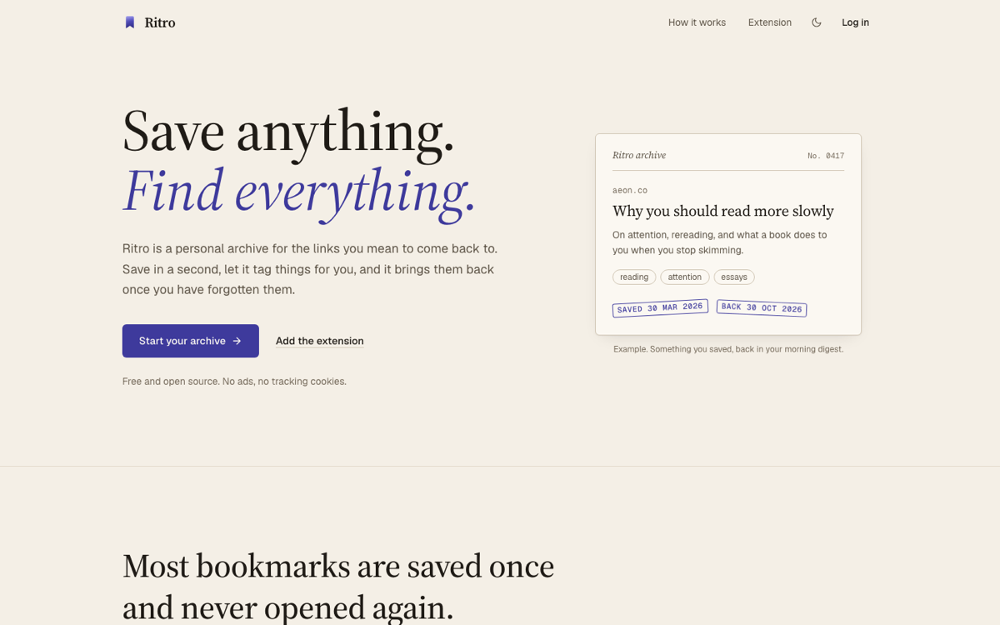
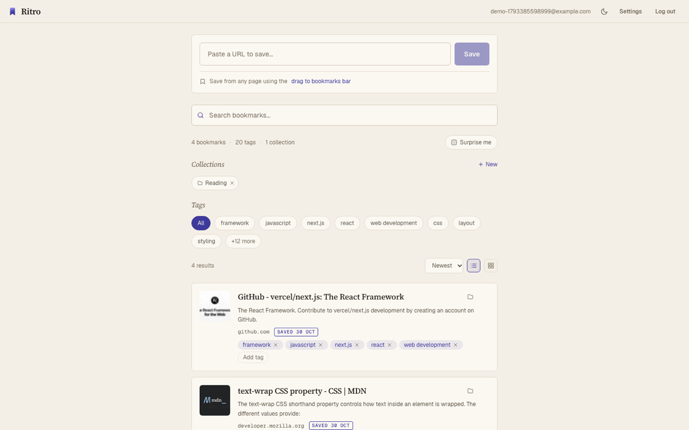
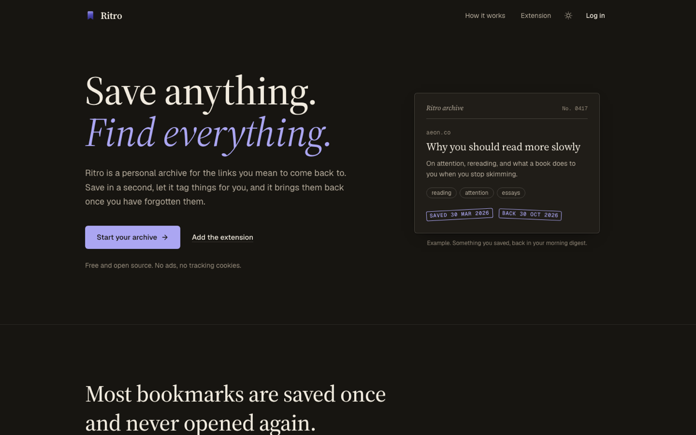
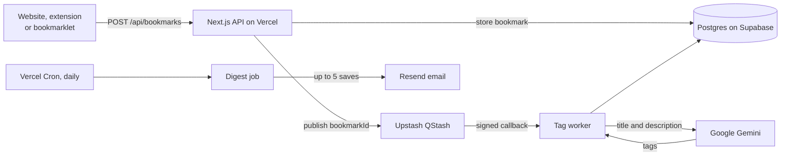

<div align="center">


# Ritro

**Save anything. Find everything.**

A personal archive for the links you mean to come back to.<br/>
Save in a second, let AI tag it, and Ritro brings it back once you've forgotten it.

[**Open Ritro**](https://ritro.vercel.app) · [Install the extension](#chrome-extension) · [Report a bug](https://github.com/ritrolabs/ritro/issues/new?template=bug_report.md)

[](https://github.com/ritrolabs/ritro/actions/workflows/ci.yml)
[](LICENSE)
[](CHANGELOG.md)



</div>

## Why Ritro

Most bookmarks are saved once and never opened again. Ritro is built around the part other tools leave out: **getting things back to you.**

- **It comes back.** Every morning, up to five things from your archive arrive in your inbox. When you have a minute, *Surprise me* pulls out one you've forgotten.
- **Saving is instant.** Paste a link, click the extension, press <kbd>Alt</kbd>+<kbd>Shift</kbd>+<kbd>S</kbd>, or use the bookmarklet in any browser. Nothing waits on the AI.
- **It files itself.** Ritro reads each page's title, description and preview image, and a few seconds later Gemini adds tags. Add your own tags or sort saves into collections if you like.
- **Find it with the words you remember.** Search looks across titles, descriptions and tags at once. Filter by tag or collection.
- **Your archive stays yours.** Export everything as JSON or delete your account from Settings at any time. No ads, no tracking cookies, and the code is open source.

<p align="center">
  
  
</p>

## How it works



1. **Save.** The API checks the link is public (no internal addresses, including after redirects), reads its metadata, stores the bookmark and replies straight away.
2. **Tag.** It puts the bookmark's ID on a QStash queue. QStash calls a signed worker route, which asks Gemini for 3 to 5 tags and stores them. Failed jobs are retried, and a daily job re-queues anything that slipped through.
3. **Bring back.** A daily job emails each user up to five saves. *Surprise me* on the dashboard picks one at random.

Rate limiting (Upstash Redis) protects saving, tagging and collections.

## Tech stack

| | |
|---|---|
| App and API | [Next.js 16](https://nextjs.org) (App Router), React 19, TypeScript |
| Styling | Tailwind CSS v4; Source Serif 4, Geist and Geist Mono, self-hosted |
| Database | PostgreSQL on [Supabase](https://supabase.com), via [Prisma 7](https://www.prisma.io) |
| Auth | Supabase Auth: email and password, Google, GitHub |
| AI | [Google Gemini](https://ai.google.dev) 2.5 Flash |
| Queue and rate limits | [Upstash](https://upstash.com) QStash and Redis |
| Email | [Resend](https://resend.com) |
| Hosting | [Vercel](https://vercel.com), with Vercel Cron, Web Analytics and Speed Insights |
| Extension | Chrome Manifest V3, plain JavaScript, popup only |

## Use it

Go to **[ritro.vercel.app](https://ritro.vercel.app)** and sign up. There's nothing to install.

### Chrome extension

> The Chrome Web Store listing is coming. Until then, load it unpacked:

1. Clone this repository and keep the folder somewhere permanent.
2. Open `chrome://extensions` and switch on **Developer mode** (top right).
3. Click **Load unpacked** and choose the `extension/` folder.
4. Pin Ritro from the puzzle-piece menu.

Save the current tab from the popup, or press <kbd>Alt</kbd>+<kbd>Shift</kbd>+<kbd>S</kbd> (<kbd>Option</kbd>+<kbd>Shift</kbd>+<kbd>S</kbd> on Mac) without opening it. Change the shortcut at `chrome://extensions/shortcuts`.

The extension signs in with email and password. If you joined with Google or GitHub, set a password first with **Forgot password?** on the website.

### Bookmarklet

On the home page, drag **Save to Ritro** to your bookmarks bar. Click it on any page, in any browser, to save that page.

## Run it locally

**You need:** Node.js 20+, a [Supabase](https://supabase.com) project, a [Gemini API key](https://aistudio.google.com/app/apikey) and an [Upstash Redis](https://upstash.com) database. All have free tiers.

```bash
git clone https://github.com/ritrolabs/ritro.git
cd ritro/client
npm install
cp .env.example .env.local   # then fill it in, see below
npx prisma generate
npx prisma db push           # creates the tables in your Supabase database
npm run dev                  # http://localhost:3000
```

AI tagging goes through QStash. Run the local QStash server in a second terminal and copy the four `QSTASH_*` values it prints into `.env.local`:

```bash
npx @upstash/qstash-cli dev
```

Without them, bookmarks still save; they just don't get AI tags.

Then apply the row-level security policies in [`client/supabase-rls.sql`](client/supabase-rls.sql) from the Supabase SQL editor.

### Environment variables

Every variable is listed with a comment in [`client/.env.example`](client/.env.example).

| Variable | What it's for |
|---|---|
| `NEXT_PUBLIC_SUPABASE_URL`, `NEXT_PUBLIC_SUPABASE_ANON_KEY` | Supabase project and its public key |
| `SUPABASE_SERVICE_ROLE_KEY` | Server-only admin key: digest, account deletion, admin page |
| `DATABASE_URL`, `DIRECT_URL` | Postgres: pooled for the app, direct for the Prisma CLI |
| `UPSTASH_REDIS_REST_URL`, `UPSTASH_REDIS_REST_TOKEN` | Rate limiting |
| `QSTASH_URL`, `QSTASH_TOKEN`, `QSTASH_CURRENT_SIGNING_KEY`, `QSTASH_NEXT_SIGNING_KEY` | Tagging queue, and checking that callbacks really come from QStash |
| `GEMINI_API_KEY` | AI tags |
| `NEXT_PUBLIC_APP_URL` | The app's public address (`http://localhost:3000` locally) |
| `CRON_SECRET` | Password Vercel Cron sends to the daily jobs; also signs unsubscribe links |
| `RESEND_API_KEY` | Sending the daily digest |
| `ADMIN_EMAILS` | Comma-separated emails allowed on `/admin` |

### Scripts

Run these from `client/`:

| Command | |
|---|---|
| `npm run dev` | Development server |
| `npm test` | Unit tests (Vitest) |
| `npm run lint` | ESLint |
| `npx tsc --noEmit` | Type check |
| `npm run build` | Production build (runs `prisma generate` first) |

## Deploying

Ritro deploys to Vercel from `main`. Set the project's root directory to `client/` and add the environment variables above (store keys and tokens as **Secret**). Use QStash's production keys, not the local ones.

`client/vercel.json` schedules two daily jobs:

| Path | When (UTC) | Does |
|---|---|---|
| `/api/digest` | 08:00 | Emails each user up to five saves |
| `/api/jobs/requeue-untagged` | 09:00 | Re-queues saves from the last two days that never got tags |

Both require `Authorization: Bearer $CRON_SECRET`, which Vercel adds automatically.

In Supabase → Authentication → URL configuration, set the Site URL to your domain and allow `https://your-domain/**` as a redirect URL.

## Project structure

```
ritro/
├── client/                    Next.js app: website and API
│   ├── src/app/               Pages and API routes (App Router)
│   │   ├── api/               bookmarks, collections, account, digest, jobs
│   │   ├── app/               Dashboard and settings
│   │   └── auth/, privacy/, terms/, bookmarklet/, admin/
│   ├── src/components/        UI components
│   ├── src/lib/               Prisma, Supabase, Gemini, queue, rate limits, URL safety
│   ├── prisma/schema.prisma   Bookmark, Tag, Collection
│   ├── DESIGN.md              The design system
│   └── PRODUCT.md             Product principles
├── extension/                 Chrome extension (Manifest V3, popup only)
├── docs/                      Release checklist, screenshots
├── CHANGELOG.md
└── THIRD_PARTY_NOTICES.md
```

## Security and privacy

- Saved links are checked before the server fetches them: public addresses only, every redirect is re-checked, and the connection itself refuses private IPs.
- The tagging worker only accepts requests signed by QStash. The daily jobs require `CRON_SECRET`.
- Row-level security keeps every table scoped to its owner.
- CI runs lint, type check, tests and a build on every pull request. CodeQL, secret scanning with push protection, and Dependabot security updates are on.
- Found a vulnerability? Please report it privately through **Security → Report a vulnerability** on GitHub, not in a public issue.

What Ritro stores, and which services process it, is set out in the [privacy policy](https://ritro.vercel.app/privacy).

## Roadmap

- [x] Website, Chrome extension and bookmarklet
- [x] Background AI tagging, collections, search
- [x] Daily digest and *Surprise me*
- [x] Data export and account deletion
- [ ] Chrome Web Store listing
- [ ] Google and GitHub sign-in in the extension
- [ ] Semantic search (pgvector)
- [ ] "You saved something similar" when you save
- [ ] Notes and photos, not just links
- [ ] Save and search from Telegram

## Contributing

Contributions are welcome.

1. Fork the repo and create a branch from `main`.
2. Make your change, then run `npm run lint`, `npx tsc --noEmit`, `npm test` and `npm run build` in `client/`.
3. Open a pull request using the template. CodeRabbit reviews every PR automatically.

For bigger changes, [open an issue](https://github.com/ritrolabs/ritro/issues) first so we can agree on the approach.

## License

Ritro is free software under the **[GNU Affero General Public License v3.0](LICENSE)**. You can use, study, change and share it. If you run a modified version as a public service, you must make your source code available to its users.

Bundled fonts and other third-party components keep their own licences; see [THIRD_PARTY_NOTICES.md](THIRD_PARTY_NOTICES.md).

---

<div align="center">

Made by [Minit Jain](https://github.com/MinitJain). Built with Next.js, Supabase, Prisma, Google Gemini, Upstash, Resend and Vercel.

</div>
